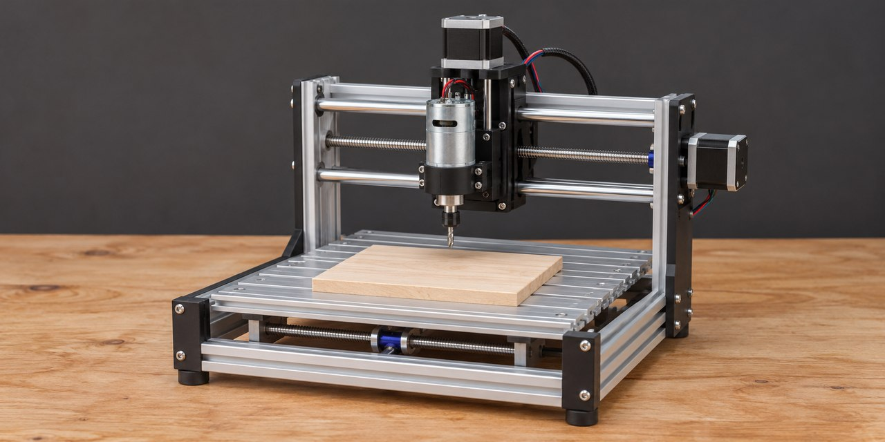

# 🛠️ RonCUT

**Dal disegno SVG al percorso fresa, su Windows.**

RonCUT prepara lavorazioni CNC, genera G-code e permette di simulare il percorso o eseguirlo su una macchina con controller GRBL 1.1. Puoi partire da un disegno vettoriale, impostare utensile e profondità e vedere dove passerà la fresa prima di avviare il lavoro.

**Versione 1.7.0** · Windows x64 · C# / WPF / .NET 8 · GPLv3



*Immagine illustrativa generata di una CNC da banco tipo 3018.*

## 🧰 Due viste, dal disegno alla macchina

| Vista | Cosa puoi fare |
| --- | --- |
| **DESIGN** | Importi l'SVG, controlli le dimensioni, scegli utensile e materiale, assegni le lavorazioni e imposti lo zero XY del pezzo. |
| **CUT** | Esamini il percorso dall'alto o in assonometria, simuli il lavoro oppure controlli una CNC GRBL tramite collegamento seriale. |

In **DESIGN** puoi creare tagli esterni o interni, incisioni, fori e tasche con isole. Puoi distribuire la profondità su più passate e aggiungere ponticelli per tenere fermo il pezzo fino alla fine del taglio. L'archivio utensili e materiali conserva profili riutilizzabili con i relativi parametri. Se selezioni più lavorazioni, puoi cambiare insieme la profondità e, dove previsti, l'altezza dei ponticelli.

Il progetto `.roncut` salva anche lo **SVG originale**, così puoi riaprire il lavoro senza il file esterno. Puoi esportare G-code per le lavorazioni senza pause di cambio utensile. Se il lavoro richiede più frese, puoi inserire pause ed eseguirlo in CUT. RonCUT ferma la fase corrente, indica quale fresa montare e consente di impostare di nuovo lo zero Z prima di riprendere.

In **CUT** puoi simulare il programma, muovere gli assi a passo o in continuo con pulsanti o tastierino, scegliere i profili **Slow** e **Fast** e regolare avanzamento e mandrino. La vista dall'alto mantiene lo stesso orientamento del disegno. Le notifiche HTTP di avvio e fine sono facoltative. Il campo dell'URL parte vuoto e l'indirizzo che scegli viene salvato nelle impostazioni locali.

In **Impostazioni generali** puoi selezionare la webcam della CNC e vederne subito l'anteprima. Dopo aver salvato, apri l'indirizzo MJPEG in un browser sulla stessa rete locale oppure impostalo in Motion con `netcam_url`. Puoi cambiare la porta HTTP, gli FPS e la qualità JPEG. La porta iniziale è 8554 e lo stream resta attivo finché RonCUT è aperto.

## ▶️ Prima prova, con il simulatore

1. Avvia `RonCUT.exe` e in **DESIGN → File → Apri progetto** apri [l'esempio con ponticelli](Esempi/test-ponticelli.roncut).
2. Osserva il contorno, i tre ponticelli e le dimensioni del pezzo. Puoi anche aprire [l'esempio con curve](Esempi/RonCUT-v2-curva.roncut) o [la tasca con due isole](Esempi/RonCUT-1.0.0-tasca-due-isole.roncut).
3. **Scollega la macchina prima di passare a CUT.** Se c'è una porta COM configurata, CUT tenta la connessione appena si apre.
4. Premi **Avvia simulatore**, verifica che compaia la scritta **SIMULAZIONE** e poi premi **START**. Puoi seguire il percorso e provare pausa, ripresa e stop.

Per importare un tuo SVG, scegliere la scala e creare le lavorazioni, consulta la [guida completa in italiano](LEGGIMI%20RonCUT.txt).

## 🔧 Compatibilità e prove

**Le prove su macchina reale sono state fatte dall'autore soltanto sulla sua CNC 3018 con controller GRBL.** RonCUT è progettato per GRBL 1.1 via seriale. La compatibilità con altre macchine, schede o versioni del firmware resta da verificare.

Le verifiche automatiche coprono, tra le altre cose, importazione SVG, percorsi, salvataggio dei progetti, collegamento simulato e impostazioni della webcam. Il simulatore aiuta a esaminare il percorso. Collisioni, limiti fisici, accelerazioni e comportamento del mandrino vanno verificati sulla macchina.

Prima di lavorare su una CNC reale controlla unità, origine, fissaggio, ingombri, utensile, avanzamenti e quota Z di sicurezza. I valori degli esempi servono alla simulazione. **PAUSA può lasciare il mandrino acceso. Usa l'arresto fisico della macchina in caso di emergenza.**

RonCUT lavora su contorni vettoriali in **2D e 2,5D**. Importa forme e tracciati SVG. Converti i testi in tracciati prima di importarli e controlla i contorni quando il disegno usa ritagli, maschere o trasparenze. La vista 3D mostra il percorso della fresa.

## 💻 Compilare RonCUT

Servono **Windows x64**, PowerShell e l'**SDK .NET 8** con supporto WPF. Scarica i sorgenti, apri PowerShell nella cartella che contiene `Compila-RonCUT.ps1` ed esegui il comando.

```powershell
.\Compila-RonCUT.ps1
```

Lo script scarica le dipendenze tramite NuGet, compila in Release, esegue i test e produce un unico **`RonCUT.exe`** nella cartella principale. L'eseguibile include il runtime .NET. Chiudi RonCUT prima di sostituirlo con una nuova compilazione. Il resoconto delle verifiche viene scritto in `VERIFICHE.txt`.

Le impostazioni della macchina, l'archivio personale di utensili e l'URL delle notifiche rimangono in `%LOCALAPPDATA%\RonCUT`.

## 🤝 Contributi e licenza

Per proporre una modifica o segnalare un problema, vedi la [guida ai contributi](CONTRIBUTING.md). Per le segnalazioni relative alla macchina, indica se hai usato il simulatore o un controller reale e specifica la versione di GRBL.

RonCUT usa la licenza **GNU GPL versione 3** (`GPL-3.0-only`). Puoi usarlo, modificarlo e distribuirlo alle condizioni della licenza. Chi distribuisce versioni modificate deve rendere disponibile il sorgente corrispondente secondo la GPLv3. [Testo della licenza](LICENSE) · [Licenze delle dipendenze](THIRD-PARTY-NOTICES.md)
